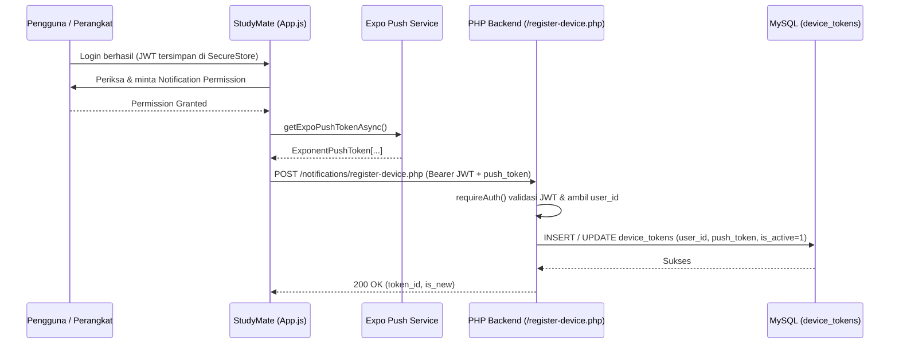
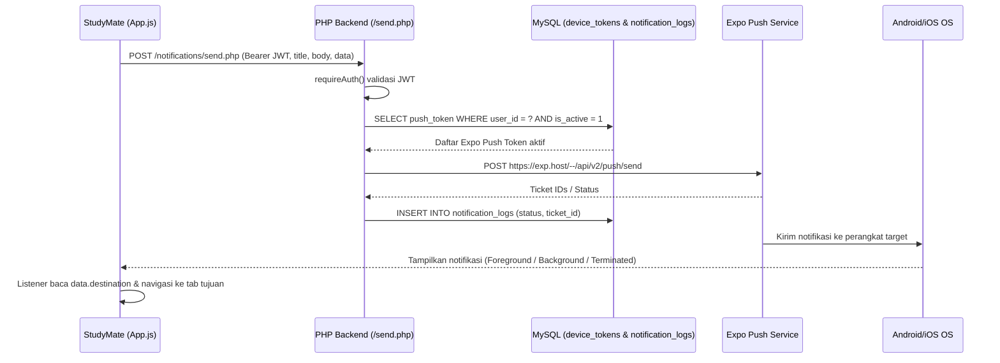

# Laporan Praktikum Week 11 – Push Notification Integration (StudyMate)

**Mata Kuliah:** Mobile Programming  
**Aplikasi:** StudyMate – Personal Study Material Organizer  
**Topik:** Push Notification (Device Registration, Server Notification & Notification Response)  
**Stack:** React Native + Expo SDK 58, `expo-notifications` v58.1.9, PHP REST API (XAMPP), MySQL, Expo Push Service  

---

## 1. Identitas Week 11

- **Nama Materi:** Push Notification Integration (`expo-notifications` & Expo Push Service).
- **Tujuan Pembelajaran:**
  1. Memahami konsep dasar Push Notification serta perbedaannya dengan In-App Notification.
  2. Memahami arsitektur pengiriman Push Notification dari Application Server hingga perangkat pengguna.
  3. Mengimplementasikan registrasi perangkat (permission request, Expo Push Token retrieval, dan penyimpanan token di backend).
  4. Mengimplementasikan endpoint server PHP untuk mengirim push notification melalui Expo Push Service dan memeriksa push receipt.
  5. Mengimplementasikan listener notifikasi pada aplikasi React Native untuk menangani kondisi *Foreground*, *Background*, dan *Terminated* beserta navigasi berbasis payload (*deep linking*).
- **Ringkasan Materi:**
  Week 11 berfokus pada integrasi notifikasi jarak jauh (*remote push notification*) yang dikirim oleh backend PHP melalui Expo Push Service ke perangkat pengguna secara *real-time*, meskipun aplikasi sedang tidak aktif.
- **Hubungan Materi dengan StudyMate:**
  StudyMate membantu mahasiswa mengelola mata kuliah, materi perkuliahan, tugas/deadline, dan jadwal kuliah. Push Notification memungkinkan StudyMate mengirimkan pengingat tugas, informasi materi baru, dan pengingat jadwal secara langsung ke perangkat mahasiswa serta mengarahkan pengguna langsung ke tab yang relevan saat notifikasi ditekan.

---

## 2. Dasar Teori

### 2.1 Pengertian Push Notification
Push Notification adalah pesan yang dikirim dari server aplikasi (*Application Server*) ke perangkat pengguna untuk menyampaikan informasi secara *real-time*, baik ketika aplikasi sedang dibuka maupun saat aplikasi berada di latar belakang (*background*) atau tertutup (*terminated*).

### 2.2 Perbedaan Push Notification dan In-App Notification
| Aspek | Push Notification | In-App Notification |
|---|---|---|
| **Sumber Pengiriman** | Dikirim dari server melalui Push Provider | Dibuat/ditampilkan langsung di dalam state aplikasi |
| **Ketersediaan** | Dapat diterima saat aplikasi di background atau terminated | Umumnya hanya terlihat saat aplikasi sedang dibuka |
| **Mekanisme** | Menggunakan Push Token & layanan OS (FCM / APNs via Expo Push Service) | Menggunakan state UI internal / modal / banner aplikasi |

### 2.3 Manfaat Push Notification
- Menyampaikan informasi penting secara tepat waktu (misalnya deadline tugas mendekat).
- Mengirim pengingat belajar sebelum jadwal kuliah dimulai.
- Menjaga keterlibatan (*engagement*) pengguna dengan alur navigasi langsung ke fitur terkait.

### 2.4 Push Notification Architecture
Alur arsitektur Push Notification terdiri dari lima komponen utama:
1. **Application Server (`studymate-api` PHP):** Sumber pesan yang menentukan isi notifikasi (*title*, *body*, *data*) serta pengguna tujuan berdasarkan token yang tersimpan di database.
2. **Push Notification Provider (Expo Push Service):** Layanan perantara yang menerima permintaan HTTP dari server aplikasi dan meneruskannya ke layanan notifikasi sistem operasi (FCM untuk Android / APNs untuk iOS).
3. **Mobile Operating System (Android / iOS):** Sistem operasi perangkat yang menerima pesan dari FCM/APNs dan menampilkannya pada panel notifikasi perangkat.
4. **Mobile Application (`StudyMate`):** Aplikasi React Native yang telah mendaftarkan perangkat, memiliki izin notifikasi, dan menangani interaksi pengguna saat notifikasi diterima atau ditekan.
5. **User Receives Message:** Pengguna melihat notifikasi dan dapat mengetuknya untuk membuka halaman tujuan di dalam aplikasi.

### 2.5 Notification Provider: Expo Push Service vs Firebase Cloud Messaging (FCM)
- **Expo Push Service:** Layanan notifikasi terintegrasi dari Expo yang menggunakan **Expo Push Token** (`ExponentPushToken[...]`). Memudahkan pengembangan aplikasi berbasis Expo karena menyediakan satu API terpadu untuk Android dan iOS (`https://exp.host/--/api/v2/push/send`).
- **Firebase Cloud Messaging (FCM):** Layanan pesan lintas platform dari Google Firebase yang menggunakan **FCM Registration Token**. Digunakan untuk integrasi native atau sebagai *transport layer* di balik layar oleh Expo Push Service pada Android.
- Pada StudyMate, provider yang digunakan adalah **Expo Push Service** dengan **Expo Push Token** agar selaras dengan arsitektur Expo SDK 58.

### 2.6 Push Token
Push Token adalah identitas unik perangkat yang diterbitkan oleh provider notifikasi untuk menentukan tujuan pengiriman pesan:
- **Expo Push Token:** Berformat `ExponentPushToken[xxxxxxxxxxxxxxxxxxxxxx]`.
- **FCM Registration Token:** Token native yang diterbitkan oleh Firebase SDK.

Alur registrasi token:
1. Aplikasi meminta izin notifikasi kepada pengguna.
2. Perangkat meminta Expo Push Token dari Expo Push Service.
3. Aplikasi menerima token dan mengirimkannya ke backend PHP (`POST /notifications/register-device.php`) bersama JWT Bearer Token.
4. Backend memvalidasi JWT, mengambil `user_id`, dan menyimpan token ke tabel `device_tokens` di MySQL.

### 2.7 Notification Payload
Notification Payload adalah struktur data JSON yang dikirim dari server ke provider dan perangkat:
- **Title:** Judul singkat notifikasi.
- **Body:** Isi pesan utama notifikasi.
- **Data Payload:** Data JSON tambahan untuk diproses oleh aplikasi, misalnya `{ "type": "task_reminder", "destination": "Tasks" }`.

### 2.8 Notification Permission & Notification Channel
- **Runtime Permission:** Izin notifikasi yang diminta secara eksplisit saat aplikasi dijalankan (wajib pada Android 13+ dan iOS).
- **Permission Granted:** Pengguna mengizinkan notifikasi; aplikasi dapat mengambil token dan menerima notifikasi.
- **Permission Denied:** Pengguna menolak izin; aplikasi tidak boleh *crash* dan harus memberikan informasi cara mengaktifkan izin melalui Pengaturan Perangkat (`Linking.openSettings()`).
- **Notification Channel (Android):** Kategori notifikasi di Android (misalnya `studymate-notifications`) untuk mengatur tingkat prioritas (`HIGH`), suara, pola getar, dan warna lampu notifikasi.

### 2.9 Application States & Notification Interaction
- **Foreground:** Aplikasi sedang aktif di layar. `Notifications.setNotificationHandler` mengatur apakah alert, suara, dan badge ditampilkan, sedangkan `addNotificationReceivedListener` menangkap payload untuk memperbarui daftar notifikasi dalam aplikasi.
- **Background:** Aplikasi berjalan di latar belakang. Sistem operasi menampilkan notifikasi secara otomatis; ketika pengguna mengetuk notifikasi, `addNotificationResponseReceivedListener` dipicu untuk membaca payload dan mengarahkan tab aktif.
- **Terminated:** Aplikasi tertutup sepenuhnya. Saat pengguna mengetuk notifikasi, aplikasi terbuka dan membaca respons awal melalui `Notifications.getLastNotificationResponse()` / `getLastNotificationResponseAsync()`, lalu menavigasi ke halaman tujuan setelah aplikasi siap.
- **Navigasi Berbasis Payload:** Proses membaca field `destination` atau `type` dari `notification.request.content.data` untuk mengarahkan pengguna langsung ke tab `Tasks`, `Materials`, `Schedule`, `Courses`, atau `Location`.

---

## 3. Analisis Kebutuhan

- **Frontend:** Satu file `App.js` pada project React Native (Expo SDK ~58.0.26, React 19.3.0, React Native 0.88.1) menggunakan `expo-notifications` v58.1.9.
- **Backend:** PHP REST API pada `C:\xampp\htdocs\studymate-api\notifications\` (disinkronkan ke `studymate-api\notifications\`) dengan dukungan cURL PHP untuk mengirim HTTP POST ke Expo Push API.
- **Database:** MySQL (`studymate_db`) dengan tabel `device_tokens` untuk menyimpan token perangkat per pengguna dan `notification_logs` untuk mencatat histori pengiriman serta *ticket ID*.
- **Notification Provider:** Expo Push Service (`https://exp.host/--/api/v2/push/send` dan `https://exp.host/--/api/v2/push/getReceipts`).
- **Perangkat:** Perangkat fisik Android/iOS (Push Notification tidak didukung pada simulator iOS dan memiliki keterbatasan pada emulator/Expo Go).
- **Authentication:** JWT Bearer Token (`Authorization: Bearer <token>`) yang disimpan di `expo-secure-store` dan divalidasi oleh `middleware/auth.php` (`requireAuth()`).
- **Koneksi Internet:** Diperlukan oleh perangkat untuk mengambil Expo Push Token dan oleh server PHP (XAMPP) untuk menghubungi endpoint `exp.host`.

### Catatan Kompatibilitas Expo Go & Development Build
Pada Expo SDK 53 ke atas (termasuk **Expo SDK 58** yang digunakan pada proyek ini), dukungan *remote push notification* di **Expo Go** (khususnya Android) telah dibatasi/dihapus oleh Expo. Untuk menguji pengiriman *remote push notification* secara penuh dan konsisten dari server ke perangkat fisik, diperlukan **Development Build** (`npx expo run:android` atau `eas build --profile development`). Jika dijalankan di Expo Go, `getExpoPushTokenAsync()` dapat melempar error atau peringatan keterbatasan Expo Go — kondisi ini sudah ditangani dengan aman oleh blok `try-catch` dan pesan informatif di UI tanpa membuat aplikasi *crash*.

---

## 4. Arsitektur Sistem

```
StudyMate Mobile (App.js)
  → PHP Backend (C:\xampp\htdocs\studymate-api\notifications\*.php)
  → Expo Push Service (https://exp.host/--/api/v2/push/send)
  → Layanan OS (FCM Android / APNs iOS)
  → Perangkat Pengguna
```

### Diagram Alur Registrasi Perangkat (Task 01)


### Diagram Alur Pengiriman & Respons Notifikasi (Task 02 & Task 03)


---

## 5. Implementasi Task 01 – Register Device

### 5.1 Dependency & Konfigurasi Expo
- **Dependency (`package.json`):** `"expo-notifications": "^58.1.9"` (terpasang pada proyek Expo `~58.0.26`).
- **Konfigurasi (`app.json`):** Menambahkan plugin `expo-notifications` dengan warna aksen `#4F46E5` dan `defaultChannel`: `"studymate-notifications"`.

```json
[
  "expo-notifications",
  {
    "color": "#4F46E5",
    "defaultChannel": "studymate-notifications"
  }
]
```

### 5.2 Permission & Push Token Retrieval (`App.js`)
Fungsi `registerForPushNotificationsAsync()` memeriksa status izin terlebih dahulu agar tidak meminta izin berulang kali jika sudah diberikan, mengatur Android notification channel `studymate-notifications`, lalu memanggil `Notifications.getExpoPushTokenAsync()`.

```javascript
const registerForPushNotificationsAsync = async () => {
  try {
    const { status: existingStatus } = await Notifications.getPermissionsAsync();
    let finalStatus = existingStatus;
    setPushNotifPermStatus(existingStatus);

    if (existingStatus !== 'granted') {
      const { status } = await Notifications.requestPermissionsAsync();
      finalStatus = status;
      setPushNotifPermStatus(status);
    }

    if (finalStatus !== 'granted') {
      setPushRegistrationError('Izin notifikasi tidak diberikan oleh pengguna.');
      return null;
    }

    const tokenData = await Notifications.getExpoPushTokenAsync({
      projectId: undefined,
    });
    const token = tokenData.data;
    setExpoPushToken(token);

    if (Platform.OS === 'android') {
      await Notifications.setNotificationChannelAsync('studymate-notifications', {
        name: 'StudyMate Notifications',
        importance: Notifications.AndroidImportance.HIGH,
        vibrationPattern: [0, 250, 250, 250],
        lightColor: '#4F46E5',
        enableVibrate: true,
        enableLights: true,
        showBadge: true,
        description: 'Notifikasi untuk pengingat tugas, materi, dan jadwal kuliah StudyMate.',
      });
    }
    return token;
  } catch (error) {
    setPushRegistrationError(error.message || 'Gagal mendapatkan push token.');
    return null;
  }
};
```

### 5.3 Pengiriman Token ke Backend & User Isolation (`App.js`)
- `sendPushTokenToBackend(token)` mengirim `POST /notifications/register-device.php` dengan JWT Bearer Auth.
- Otomatis dipanggil oleh `useEffect` saat `isAuthenticated && apiUser?.id` bernilai benar.
- Saat logout (`handleApiLogout`), aplikasi memanggil `unregisterPushToken()` (`POST /notifications/unregister-device.php`) **sebelum** token JWT dicabut, lalu mereset state push notification lokal agar token akun A tidak terbawa ke akun B.

### 5.4 Struktur Tabel Database (`week11_migration.sql`)
- **`device_tokens`:** `id`, `user_id` (FK ke `users.id`), `push_token` (UNIQUE), `platform`, `is_active`, `created_at`, `updated_at`.
- **`notification_logs`:** `id`, `user_id` (FK ke `users.id`), `title`, `body`, `data` (JSON), `status`, `ticket_id`, `created_at`.

### 5.5 File yang Dibuat / Diubah (Task 01)
- `d:\SEMESTER 5\MOBILE\studymate-mobile\package.json` (menambah `expo-notifications`)
- `d:\SEMESTER 5\MOBILE\studymate-mobile\app.json` (menambah plugin `expo-notifications`)
- `d:\SEMESTER 5\MOBILE\studymate-mobile\App.js` (state, fungsi registrasi/unregistrasi, UI status)
- `C:\xampp\htdocs\studymate-api\notifications\week11_migration.sql`
- `C:\xampp\htdocs\studymate-api\notifications\register-device.php`
- `C:\xampp\htdocs\studymate-api\notifications\unregister-device.php`

---

## 6. Implementasi Task 02 – Push Notification

### 6.1 Endpoint Backend
1. **`POST /notifications/send.php`**
   - Memvalidasi JWT via `requireAuth()`.
   - Mengambil semua `push_token` dengan `is_active = 1` milik `target_user_id` (default: user yang sedang login).
   - Membentuk payload Expo Push API (`to`, `sound`, `title`, `body`, `data`, `priority: 'high'`, `channelId: 'studymate-notifications'`).
   - Mengirim request HTTP POST via cURL ke `https://exp.host/--/api/v2/push/send`.
   - Mencatat log pengiriman beserta `ticket_id` ke tabel `notification_logs`.
2. **`POST /notifications/receipts.php`**
   - Memvalidasi JWT via `requireAuth()`.
   - Menerima `ticket_ids` dan mengecek status pemrosesan ke `https://exp.host/--/api/v2/push/getReceipts`.
   - Membedakan status: request diterima Expo Push Service (ticket) vs status pemrosesan ke FCM/APNs (receipt).
3. **`GET /notifications/history.php`**
   - Mengembalikan riwayat notifikasi pengguna dari `notification_logs` dengan pagination (`limit`, `offset`).

### 6.2 Contoh Request & Response Aktual (`POST /notifications/send.php`)
**Request:**
```json
POST /studymate-api/notifications/send.php
Authorization: Bearer <JWT_TOKEN>
Content-Type: application/json

{
  "title": "📚 StudyMate Reminder",
  "body": "Hai Ahmad! Jangan lupa pelajari materi untuk kuliah besok.",
  "data": {
    "type": "study_reminder",
    "destination": "Materials"
  }
}
```

**Response Sukses (200 OK):**
```json
{
  "success": true,
  "message": "Push notification berhasil dikirim.",
  "target_user_id": 1,
  "tokens_sent": 1,
  "tokens_failed": 0,
  "tickets": ["xxxxxxxx-xxxx-xxxx-xxxx-xxxxxxxxxxxx"],
  "failed_details": [],
  "expo_response_code": 200
}
```

**Response Error (404 Not Found – Belum Ada Perangkat Terdaftar):**
```json
{
  "success": false,
  "message": "Tidak ada perangkat terdaftar untuk pengguna target.",
  "target_user_id": 1,
  "tokens_found": 0
}
```

### 6.3 Error Handling & Keamanan
- Seluruh endpoint dilindungi `requireAuth()` sehingga tidak ada endpoint publik yang dapat mengirim notifikasi secara anonim.
- `user_id` untuk registrasi/riwayat diambil dari payload JWT (`$payload['sub']`), bukan dari input bebas.
- Menangani kasus token tidak ditemukan (`404`), token format tidak valid (`400`), koneksi cURL ke Expo gagal (`502`), dan error database PDO (`500`).

---

## 7. Implementasi Task 03 – Handle Notification Response

### 7.1 Konfigurasi Foreground Handler (`App.js` Level Modul)
```javascript
Notifications.setNotificationHandler({
  handleNotification: async () => ({
    shouldShowAlert: true,
    shouldPlaySound: true,
    shouldSetBadge: true,
    shouldShowBanner: true,
    shouldShowList: true,
  }),
});
```

### 7.2 Listener & Navigasi Berbasis Payload (`App.js` Top-Level `useEffect`)
- **`addNotificationReceivedListener`:** Menerima notifikasi saat aplikasi di *foreground*, menyimpan ke `lastPushNotification`, dan menambahkannya ke daftar `notifications` dalam aplikasi.
- **`addNotificationResponseReceivedListener`:** Menangani ketukan (*tap*) notifikasi saat aplikasi di *foreground* atau *background*, membaca `data.destination || data.type`, lalu memanggil `setCurrentTab(...)`:
  - `tasks` / `task_reminder` → `'Tasks'`
  - `materials` / `material_announcement` / `study_reminder` → `'Materials'`
  - `schedule` / `schedule_reminder` → `'Schedule'`
  - `courses` → `'Courses'`
  - `location` → `'Location'`
  - Payload tidak dikenal / kosong → `'Home'` (aman tanpa *crash*).
- **Terminated State:** `handleInitialNotification()` memanggil `Notifications.getLastNotificationResponse()` (dengan fallback `getLastNotificationResponseAsync()`) saat komponen mount untuk mendeteksi notifikasi yang membuka aplikasi dari kondisi tertutup.
- **Cleanup:** Membersihkan subscription dengan `notificationListenerRef.current.remove()` dan `notificationResponseRef.current.remove()` agar tidak terjadi listener ganda.

---

## 8. Integrasi dengan StudyMate

- **Login & JWT:** Registrasi push token otomatis berjalan setelah pengguna terautentikasi dan memiliki JWT valid.
- **Profile & Settings (`renderScheduleProfileScreen`):** Menampilkan kartu **Status Push Notification** berisi status izin perangkat (`Aktif` / `Ditolak` / `Menunggu`), status registrasi ke server (`Terdaftar` / `Belum`), tombol aktivasi/perbarui registrasi, tombol **Buka Pengaturan HP** (`Linking.openSettings()`) saat izin ditolak, serta tombol **Kirim Pengingat** untuk menguji pengiriman nyata dari server ketika perangkat terdaftar.
- **Tugas, Materi, & Jadwal:** Notifikasi yang diketuk otomatis mengarahkan pengguna ke tab `Tasks`, `Materials`, atau `Schedule` sesuai payload.
- **User Data Isolation:** Logout menonaktifkan token perangkat di backend (`is_active = 0`) dan membersihkan seluruh state notifikasi lokal.

---

## 9. Pengujian Sistem

| Nomor | Skenario Pengujian | Langkah Pengujian | Hasil yang Diharapkan | Hasil Aktual | Status |
|---|---|---|---|---|---|
| 1 | Validasi Sintaks `App.js` | Menjalankan parser Babel (`@babel/parser`) pada `App.js` | Sintaks JSX/ES6 valid tanpa error | `VALID: 10245 lines` (setelah fix ReferenceError, Expo Go handling, & Notification Channel) | LULUS |
| 2 | Validasi Sintaks PHP Backend | Menjalankan `php -l` pada seluruh file di `notifications/` | Tidak ada syntax error PHP | `No syntax errors detected` pada `history.php`, `receipts.php`, `register-device.php`, `send.php`, `unregister-device.php` | LULUS |
| 3 | Task 01 – Permission & Token Retrieval | Login di perangkat fisik, cek izin notifikasi, ambil Expo Push Token | Izin diminta sekali, Expo Push Token diperoleh | Memerlukan perangkat fisik + Development Build (MySQL/Apache XAMPP belum aktif saat verifikasi) | BELUM DIUJI |
| 4 | Task 01 – Register Device ke Backend | Kirim `POST /notifications/register-device.php` dengan JWT valid | Token tersimpan di tabel `device_tokens` dengan `user_id` sesuai JWT | Memerlukan XAMPP MySQL & Apache aktif | BELUM DIUJI |
| 5 | Task 02 – Kirim Push Notification dari Server | Jalankan `POST /notifications/send.php` dengan JWT & payload valid | Server mengirim ke `exp.host`, mencatat ke `notification_logs`, perangkat menerima notifikasi | Memerlukan XAMPP aktif + perangkat fisik terdaftar | BELUM DIUJI |
| 6 | Task 03 – Foreground, Background, Terminated & Tap Navigation | Ketuk notifikasi pada ketiga state dengan payload `task_reminder`, `material_announcement`, `schedule_reminder` | Aplikasi membuka tab `Tasks`, `Materials`, atau `Schedule` sesuai payload | Memerlukan perangkat fisik + Development Build | BELUM DIUJI |
| 7 | Task 03 – Invalid Payload | Kirim notifikasi dengan `data: {}` atau `destination` tidak dikenal | Aplikasi tidak crash dan aman mengarahkan ke `Home` | Memerlukan perangkat fisik | BELUM DIUJI |
| 8 | User Isolation | Login Akun A → registrasi token → Logout → Login Akun B | Token Akun A dinonaktifkan saat logout, tidak menerima notifikasi Akun B | Memerlukan XAMPP aktif + perangkat fisik | BELUM DIUJI |
| 9 | Permission Denied & Pengaturan HP | Tolak izin notifikasi, buka tab Jadwal & Profil, tekan "Buka Pengaturan HP" | Badge "Ditolak" tampil, aplikasi tidak crash, Pengaturan HP terbuka | Memerlukan perangkat fisik | BELUM DIUJI |

---

## 10. Kendala dan Solusi

1. **Perubahan API Cleanup Listener di `expo-notifications` v58.1.9:**
   - *Kendala:* Pada versi `expo-notifications` SDK 58 (`58.1.9`), fungsi `Notifications.removeNotificationSubscription()` sudah tidak diekspor pada `index.d.ts`, sedangkan `addNotificationReceivedListener` dan `addNotificationResponseReceivedListener` mengembalikan objek `EventSubscription` yang memiliki metode `.remove()`.
   - *Solusi:* Menggunakan `notificationListenerRef.current.remove()` dan `notificationResponseRef.current.remove()` pada cleanup `useEffect`, serta mendukung `Notifications.getLastNotificationResponse()` dengan fallback `getLastNotificationResponseAsync()`.
2. **Keterbatasan Remote Push Notification di Expo Go (SDK 53+ / SDK 58):**
   - *Kendala:* `Notifications.getExpoPushTokenAsync()` melempar error `"Android Push notifications (remote notifications) functionality was removed from Expo Go with SDK 53. Use a development build instead of Expo Go."` saat dijalankan di Expo Go Android.
   - *Solusi:* Memisahkan panggilan `getExpoPushTokenAsync()` ke dalam blok `try-catch` tersendiri di dalam `registerForPushNotificationsAsync()`. Error Expo Go terdeteksi berdasarkan pesan error (`errMsg.includes('removed from Expo Go')`) dan ditangani dengan menampilkan pesan informatif kepada pengguna di UI tanpa *crash*. Menginstal `expo-dev-client` dan menambahkan `android.package` pada `app.json` agar Development Build dapat dibuat dengan `npx expo run:android`.
3. **ReferenceError: Property 'result' doesn't exist (di `handleApiLogin`):**
   - *Kendala:* Variabel `result` dideklarasikan dengan `const` di dalam blok `try { ... }` pada `handleApiLogin()`, tetapi diakses kembali di Step 4 (setelah blok `try/catch/finally`), sehingga `result` sudah berada di luar scope dan menyebabkan `ReferenceError` saat runtime.
   - *Solusi:* Mengganti deklarasi menjadi `let loginResult = null;` di luar blok `try`, dan menggunakan nama `loginResult` pada seluruh referensi di dalam maupun di luar blok `try/catch/finally`.
4. **NullPointerException pada `ExpoNotificationChannelManager.setNotificationChannelAsync`:**
   - *Kendala:* Pemanggilan `Notifications.setNotificationChannelAsync('studymate-notifications', { ..., sound: 'default' })` melempar `java.lang.NullPointerException: Attempt to invoke virtual method java.lang.Class java.lang.Object.getClass() on a null object`. Pada implementasi native `AndroidXNotificationsChannelManager.java` (`expo-notifications` `58.1.9`), keberadaan key `sound` tanpa `audioAttributes` memicu pemanggilan `channel.setSound(soundUri, soundAttributes)` dengan `soundAttributes` bernilai `null`.
   - *Solusi:* Menghapus properti `sound: 'default'` dari konfigurasi `setNotificationChannelAsync()` dan menambahkan `enableVibrate: true`, `enableLights: true`, serta `showBadge: true`. Tanpa properti `sound`, Android `NotificationChannel` secara otomatis menggunakan suara notifikasi default sistem beserta `AudioAttributes` default.
5. **Layanan XAMPP Belum Berjalan Saat Sesi Implementasi:**
   - *Kendala:* Port `3306` (MySQL) dan `80` (Apache) tidak aktif saat pemeriksaan koneksi lokal di sesi ini.
   - *Solusi:* Seluruh file SQL migrasi dan endpoint PHP telah dibuat dan disinkronkan; pengujian end-to-end dicatat sebagai `BELUM DIUJI` pada tabel pengujian dan siap dijalankan setelah XAMPP diaktifkan.

---

## 11. Cara Menjalankan Project

1. **Jalankan XAMPP:**
   - Buka **XAMPP Control Panel**, lalu klik **Start** pada **Apache** dan **MySQL**.
2. **Jalankan Migrasi Database Week 11:**
   - Buka `http://localhost/phpmyadmin` → pilih database `studymate_db` → tab **SQL** → jalankan isi file `C:\xampp\htdocs\studymate-api\notifications\week11_migration.sql`.
3. **Konfigurasi IP Backend di `App.js`:**
   - Cek IP lokal laptop dengan `ipconfig`, lalu pastikan `API_URL` di `App.js` mengarah ke `http://<IP_LOKAL>/studymate-api`.
4. **Jalankan Expo / Development Build pada Perangkat Fisik:**
   ```bash
   cd "d:\SEMESTER 5\MOBILE\studymate-mobile"
   ```
   **Opsi A – Development Build (WAJIB untuk Push Notification Android):**
   ```bash
   npx expo run:android
   ```
   Perintah ini akan mem-build APK development secara lokal, menginstalnya ke perangkat/emulator Android, dan menjalankan Expo Dev Server. Memerlukan:
   - Android SDK terinstal (via Android Studio).
   - Perangkat fisik terhubung via USB dengan USB Debugging aktif, **ATAU** emulator Android berjalan.
   - `ANDROID_HOME` / `ANDROID_SDK_ROOT` environment variable terkonfigurasi.
   
   **Opsi B – EAS Build (jika build lokal gagal):**
   ```bash
   npm install -g eas-cli
   eas login
   eas build --profile development --platform android
   ```
   Setelah APK selesai di-build di cloud EAS, download dan instal ke HP fisik, lalu jalankan:
   ```bash
   npx expo start --dev-client
   ```
   
   **Opsi C – Expo Go (TERBATAS, push notification remote TIDAK berfungsi):**
   ```bash
   npx expo start
   ```
   Fitur lain (login, materi, tugas, jadwal, lokasi) tetap berfungsi di Expo Go. Namun `getExpoPushTokenAsync()` akan gagal dan UI akan menampilkan pesan informatif.
5. **Uji Registrasi, Pengiriman & Navigasi:**
   - Login ke aplikasi StudyMate di HP fisik → izinkan notifikasi saat diminta.
   - Buka tab **Jadwal** → gulir ke **Status Push Notification** → pastikan status izin **Aktif** dan registrasi **Terdaftar**.
   - Tekan **Kirim Pengingat** (atau kirim request ke `POST /notifications/send.php` menggunakan Postman/cURL) → ketuk notifikasi yang masuk untuk memverifikasi navigasi otomatis ke tab tujuan.

---

## 12. Panduan Demo / Live Coding

1. **Jelaskan Konsep Push Notification:** Bedakan Push Notification (dari server via Expo Push Service, bisa masuk saat background/terminated) dengan In-App Notification.
2. **Jalankan StudyMate & Login:** Tunjukkan aplikasi berjalan di perangkat fisik dan pengguna login menggunakan JWT.
3. **Buka Pengaturan Notifikasi:** Arahkan ke tab **Jadwal** → bagian **Status Push Notification**.
4. **Minta Permission & Dapatkan Expo Push Token:** Tekan **Aktifkan Notifikasi**, jelaskan fungsi `registerForPushNotificationsAsync()` yang mengecek izin dan memanggil `Notifications.getExpoPushTokenAsync()`.
5. **Jelaskan Registrasi Token ke Backend:** Tunjukkan `sendPushTokenToBackend()` mengirim token ke `POST /notifications/register-device.php` dengan header `Authorization: Bearer <token>`.
6. **Periksa Token di Database:** Buka phpMyAdmin → tabel `device_tokens` → tunjukkan baris token milik `user_id` yang login (`is_active = 1`).
7. **Kirim Notifikasi dari Server:** Tekan **Kirim Pengingat** atau kirim request `POST /notifications/send.php` berisi `title`, `body`, dan `data: { "destination": "Tasks" }`.
8. **Perlihatkan Notifikasi di Perangkat:** Tunjukkan notifikasi muncul di layar HP.
9. **Tekan Notifikasi & Tunjukkan Halaman Tujuan:** Ketuk notifikasi → aplikasi otomatis berpindah ke tab **Tugas** (atau **Materi** / **Jadwal** sesuai `data.destination`).
10. **Jelaskan 3 Application State:**
    - *Foreground:* Ditangani oleh `setNotificationHandler` & `addNotificationReceivedListener`.
    - *Background:* Ditampilkan oleh OS, tap ditangani oleh `addNotificationResponseReceivedListener`.
    - *Terminated:* Tap membuka aplikasi, dibaca saat startup oleh `getLastNotificationResponse()`.

---

## 13. Kesimpulan

Implementasi Week 11 Push Notification pada StudyMate telah selesai dibangun mencakup ketiga task utama:
- **Task 01 (Device Registration):** Permintaan izin notifikasi, pengambilan Expo Push Token, pengiriman ke backend PHP dengan JWT Auth, penyimpanan di tabel `device_tokens`, serta penonaktifan token saat logout untuk menjaga *User Data Isolation*.
- **Task 02 (Server Notification):** Endpoint `send.php`, `receipts.php`, dan `history.php` yang terintegrasi dengan Expo Push Service (`exp.host`) dan pencatatan log ke `notification_logs`.
- **Task 03 (Notification Response):** Listener untuk *foreground*, *background*, dan *terminated* di `App.js` yang membaca `data.destination` / `data.type` dan menavigasi pengguna ke tab yang relevan dengan aman.

**Batasan Sistem:** Pengujian langsung pada perangkat fisik belum dilakukan pada sesi ini karena layanan XAMPP lokal belum berjalan dan pengujian *remote push notification* pada Expo SDK 58 memerlukan perangkat fisik dengan Development Build.

---

## 14. Referensi

1. Expo Documentation – *Notifications (`expo-notifications`)*: https://docs.expo.dev/versions/latest/sdk/notifications/
2. Expo Documentation – *Push Notifications Overview & Setup*: https://docs.expo.dev/push-notifications/overview/
3. Expo Documentation – *Sending Notifications with Expo's Push API*: https://docs.expo.dev/push-notifications/sending-notifications/
4. React Native Documentation – *Linking*: https://reactnative.dev/docs/linking
